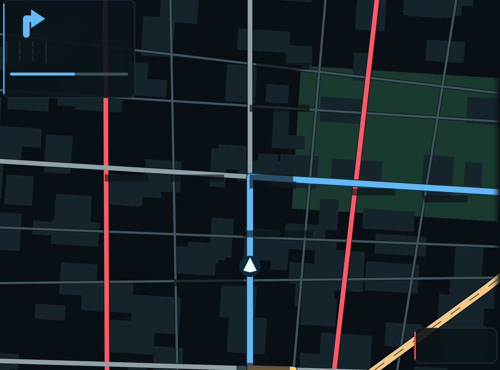
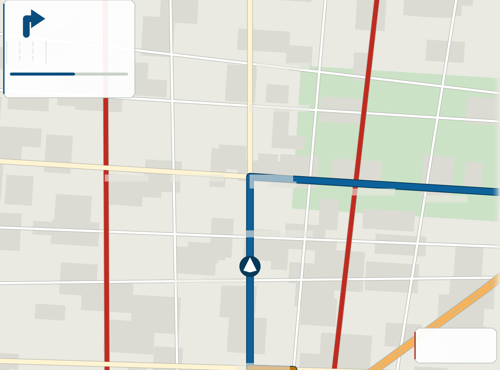

# dash

A car dashboard in a terminal, built on [conui](https://github.com/masterela/conui): a routable
city, A\* navigation, and a map drawn from geometry on every frame. No tiles, no images, no
pre-rendering.

```
git clone https://github.com/masterela/conui
git clone https://github.com/masterela/dash
cd dash && cargo run --release
```

conui is a **path dependency on a sibling checkout** — `../conui/crates/conui` — rather than a
version from crates.io or a git revision. That is deliberate while both are moving: this app is
conui's hardest customer, and a change to the library has to be drivable here in the same edit. The
cost is that the two directories have to sit next to each other. Once conui is published, this
becomes a version like anything else.

The map pane is **real pixels** — a full-colour image rendered per frame and handed to the terminal
through the kitty graphics protocol, which kitty, Ghostty and WezTerm all speak. Everything else is
terminal cells. That split is the whole design: pixels for geometry, cells for language. The text is
drawn by the terminal at the terminal's own resolution, which is sharper than any bitmap font this
program could carry, and it lands on top of the picture because the image is placed at `z=-1` —
above the cell backgrounds, below the glyphs.

On a terminal that cannot show a picture, the same camera and the same labels drive a braille
renderer instead, and you can ask for it anywhere with `--braille`. `--light` swaps the night skin
for a paper one; the hues barely move, what moves is which end of the scale carries the ink.

## What it looks like

The two skins, at 204x58. These are the **pixel layer on its own** — `--png` writes exactly the
bytes that go to the terminal, which is how the render gets checked without a terminal involved.

| night (default) | `--light` |
| --- | --- |
|  |  |

The two plates are empty on purpose, and they are the clearest picture of the whole design in this
file: the manoeuvre card's rectangle, its arrow, its lane bank and its countdown are pixels, and the
words and the block digits that go inside it are *not here at all*. The terminal draws those, in its
own font, on top — so a screenshot of the picture has holes in it exactly where the language goes.

The other half, the same frame as cells (`--dump 132 36`):

```
▄█  █▀█  ▀  ▀▀█ ▄█   DASH                                        ▀▀█ ▄█  °C                        ♫ Nocturne in E♭
 █  █▀█     ▀▀█  █   Av. de l'Opéra                           ☀  █▀▀  █                              Chopin      1:05 / 4:31
▀▀▀ ▀▀▀  ▀  ▀▀▀ ▀▀▀  1500 m · heading up                         ▀▀▀ ▀▀▀ clear                     ◀◀   ▌▐   ▶▶  ━━━━━━━━━━
──────────────────────────────────────────────────────────────────────────────────────────────────────────────────────────────
⠤╭──────────────────────────────────────╮     ⣿            ⢀⠇        ⣿             ⢰⠁        │TO Parking Bastille
 │             ▀▀█ ▀▀█ █▀█              │     ⣿            ⢸        ⢰⡏             ⡸         │─────────────────────────────────
 │  ↱          █▀▀   █ █ █              │     ⣿            ⢸        ⢸⡇             ⡇         │ARRIVAL          in 2 min
 │             ▀▀▀   ▀ ▀▀▀ m            │⠉⠉⠓⠒⠒⣿⠢Rue Saint-Lazare    ⣾⠃            ⢰⠃         │        ▄█  █▀█  ▀  ▀▀█ ▀▀█
 │                                      │     ⣿         ⠉⠉⠉⡏⠓⠒⠒⠒⠦⠤⠤⠤⣿⣀⣀⣀⣀         ⢸          │         █  █▀█     ▀▀█ ▀▀█
⣀│             turn right onto          │     ⣿            ⡇       ⢠⡟   ⠈⠉⠉⠉⠉⠒⠒⠒⠒⠦⡧⠤⠤⢄⣀⣀⣀⣀   │        ▀▀▀ ▀▀▀  ▀  ▀▀▀ ▀▀▀
 │                                      │     ⣿           ⢰⠃       ⢸⡇            ⢠⠃      ⠈⠉⠉⠉│LEFT    2.5 km   via Rue de Rivoli
 │                                      │⠉⠑⠒⠒⠒◆ Parking Concorde⣀⣀⡀⣼⠇            ⢸           │TRAFFIC clear
 │                                      │     ⣿           ⢸       ⠈⣿⠉⠉⠉⠉⠉⠉⠑⠒⠒⠒⠒⠒⠒⡟⠢⠤⠤⠤⠤⠤⠤⠤⢄⣀⣀│─────────────────────────────────
 │ Rue de Rivoli                        │     ⣿           ⡞        ⣿            ⢀⠇           │ROUTE            1 more turn
 │ ━━━━━━━━━━━━━━━━━━━━━━━━━━━━━━━━━━━━ │     ⣿           ⡇       ⢸⡇            ⢸            │↰ Bd Voltaire
 │                                      │     ⣿           ⡇       ⢸⡇            ⡏            │  ▀▀█     ▀▀█
⠶│ then ↰ Bd Voltaire                   │     ⣿          ⢰⠁       ⣿            ⢀⠇            │  █▀▀     ▀▀█ km
 ╰──────────────────────────────────────╯⣤⣤⣄⣀⣀Rue de Rivoli       ⣿            ⢸             │  ▀▀▀ ▀   ▀▀▀
                   Rue de Rennes⡇          ⠈⠉⠉⣿⠉⠉⠉⠉⠙⠛⠛⠛⠛⠛⢻⠛⠳⠶⠶⠶⠶⠶⢶⡿⢶⣤⣤⣤⣤⣤⣤⣤⣄⣀⣀⣀⣎⣀⣀⣀⣀         │
                   ⢿⡀           ⡇             Av. de l'Opéra     ⢸⡇        ⠈⠉⠉⢉⡏⠉⠉⠉⠙⠛⠛⠛⠛⠛⠛⠛⠻⠶│◆ Parking Bastille
                   ⢸⡇           ⡇             ⣿          ⡇       Bd Sébastopol⢸              │  ▀▀█     █▀▀
                   ⢸⡇           ⡇             ⣿          ⡇       ⣿            ⡜              │  █▀▀     ▀▀█ km
⠤⠤⢤⣀⣀⣀⣀⣀⣀⣀⣀⣀⣀⣀⣀⣀   ⢸⡇           ⡇             ⣿         ⢸⠁      ⢠⡿            ⡇              │  ▀▀▀ ▀   ▀▀▀
                ⠉⠉⠉⢹⡏⠉⠉⠉⠉⠉⠉⠉⠙⠒⠒⠒⢳⠒⠒⠒⠒⠒⠒⠒⠒⠢⠤⠤⠤Quai de la Mégisserie⣀⣀         ⢸               │
                   ⢸⡇           ⢸             ⣿         ⢸       ⣸⠇ ⠈⠉⠉⠉⠉⠉⠉⠉⠉⠉⡽⠉⠉⠑⠒⠒⠒⠒⠒⠒⠒⠒⠒⠒⠒⠒│
                   ⢸⡇           ⢸             ⣿         ⡇       ⣿            ⡇               │
                   ⢸⡇           ⢸             ▲         ⡇      ⢀⣿           ⢰⠁               │
⣀⣀⣀⣀⣀⣀⣀⣀⣀⣀⣀⣀⣀⣀⣀⣀⣀⣀⣀⣸⣇⣀⣀⠤⠤⠤⠤⠤⠤⠤⠤⠤◆ Hôpital Saint-Louis⠤⠤⢤⠧⠤⠤⠤⠤⠤⠤⢼⡧⠤⠤⠤⠖⠒⠒⠒⠒⠒⠒⠒⡺⠒⠒⠒⠒⠒⠒⠒⠒⠒⠒⠒⠒⠒⢒⣶⣾│
                   ⢸⡇           ⢸             ⣿        ⢸       ⢸⡇           ⡇           ⣠⣶⡿⠋⠁│
                   ⢸⡇           ⢸             ⣿        ⢸       ⣿   ╭───────────────────────╮ │
                   ⢸⡇           ⢸             ⣿        ⡼       ⣿   │    ▀▀█ █▀▀  ▲ 6 over  │ │─────────────────────────────────
                   ⢸⡇           ⢸             ⣿        ⡇      ⢰⡟   │      █ █▀█  km/h      │ │FUEL    ━━━━━━━━━━━━        71 %
                   ⢸⡇           ⢸             ⣿        ⡇      ⢸⡇   │      ▀ ▀▀▀  LIMIT 70  │ │RANGE   460 km
                   ⢸⡇           ⢸             ⣿       ⢀⠇      ⣼⠃   ╰───────────────────────╯ │TRIP    0.4 km
                   ⢸⡇           ⢸             ⣿       ⢸       ⣿        ⢀⢤⣾⡟⠋                 │
s search  n north  p pause  +/- zoom  r next stop  q quit  m ‹ › music                        routing to Parking Bastille
```

That is the braille fallback standing in for the map, because a dump is text and text is all it can
be — but the strip, the rail and the two plates' contents are the *same cells* the pixel version
draws, in the same places. Run it in Ghostty, kitty or WezTerm and the braille is replaced by the
picture above, underneath all of it.

It starts driving immediately. Keys:

| key     | what it does                             |
| ------- | ---------------------------------------- |
| `s`     | search for somewhere to go, then `ENTER` |
| `n`     | north-up instead of heading-up           |
| `+` `-` | zoom, 180 m to 5.2 km across             |
| `p`     | pause                                    |
| `r`     | pick the next stop and route there       |
| `m`     | play or pause the music                  |
| `<` `>` | previous or next track                   |
| `q`     | quit                                     |

```
cargo run --release                        drive, at 60 fps
cargo run --release -- --time              what a frame costs, by thread count
cargo run --release -- --probe             find out what this terminal will actually show
cargo run --release -- --inline            pixels in the escape instead of through a temp file
cargo run --release -- --light             paper, for sunlight, instead of night
cargo run --release -- --braille           drive without the picture
cargo run --release -- --cell 9x18         tell it how big a cell really is
cargo run --release -- --fps 30            redraw faster, if the pty can take it
cargo run -- --dump 160 44                 one frame as text, to check the layout
cargo run -- --dump 160 44 --find pharm    the same, with a search running in the rail
cargo run -- --png /tmp/dash.png 160 44    one frame as a picture, to check the render
```

`--dump`, `--png` and `--time` take `COLS ROWS [SECONDS]` and need no terminal, which is how both
renderers get checked. `--png` honours `--cell`, so `--cell 20x42 --png …` is how a pictogram gets
looked at closely.

## Designed for a glance, not a read

The screen this is for is ten inches, in a car, half a metre from someone who is looking at the
road. That single fact gives a hierarchy rather than a taste. At that distance one terminal cell is
about three millimetres tall and subtends roughly **twenty arcminutes** — the floor for legibility,
fine to read and far too small to glance at. Block digits are three rows, so about **seventy**; a
shape drawn in pixels gets four rows or more, so **ninety** and up. So:

| tier       | what is in it                                         | how it is drawn               |
| ---------- | ----------------------------------------------------- | ----------------------------- |
| act on it  | the next manoeuvre, the distance, the lane, the speed  | drawn shapes and block digits |
| confirm it | which street, arrival time, distance to go             | ordinary cell text            |
| ambient    | fuel, range, trip, traffic                             | dim, bottom of the rail       |

The two things a driver acts on get plates of their own in the map pane, as far apart as it allows so
that a glance aimed at one cannot land on the other: the **manoeuvre card** is the top-left — forty
cells by fourteen — and the **speedometer** is the bottom-right. Both are drawn into the picture and
the map shows through both.

Inside them the split is the same one as everywhere else, one level down: the shapes are pixels and
every number is cells. A number is *read*, and three rows of block digit is plenty to read at half a
metre; a shape is *recognised*, which wants the four to eight rows only the picture can give. So the
arrow, the lane bank and the countdown are drawn, and the distance, the speed and the limit are the
same block digits as the arrival clock in the rail — because a dash with one number treatment is a
dash whose readouts are learnable. The limit floats beside the speed at cell size, unboxed: it is
worth knowing and not worth a glance, and a roundel drawn around it is both a second rectangle inside
a rectangle and a thing that has to be sized to fit what it encloses.

The speed is the one reading with three states, and they are the reason it has a colour at all: plain
under the limit, **amber within two per cent of it**, **red at one over**. Amber before the limit is
broken rather than after is the only part of the scale where a dash can be useful instead of merely
accurate — it is the band in which a driver is about to break a limit without having decided to. Red at
one over rather than at four is a refusal to take a view: a readout that quietly allows the first three
has an opinion about the law. The plate's edge takes all three states and the `LIMIT` line — quiet while
all is well — takes the other two, because a red number beside a grey limit reads as one of the pair
being broken without saying which. The `▲ 8 over` row is separate and appears at four over, where the
amount stops being the speedometer's own rounding and starts being a number to act on.

Four rules keep the card glanceable rather than merely large:

- **Nothing moves.** Same rectangle, same rows, every moment of every drive. The lane rows stay
  empty rather than closing up. A driver who has to *find* a number has already spent the glance.
- **Nothing speaks until it matters.** The lane bank fills out inside 250 m and the card's edge and
  countdown step from calm to pressing inside 150 m. Permanent furniture teaches the eye to skip it,
  so the only way for "now" to mean anything is for it to be absent beforehand.
- **The lanes are the road, seen from above.** Solid kerbs, dashed dividers, one painted arrow per
  lane — the carriageway as it is actually marked, so it needs no key. It sits under the pictogram, in
  the same columns, with one clear row between them: the arrow's tail and the markings both end in a
  round cap, and a cap's width of space is the difference between two shapes and one shape with a
  kink in it. The arrow in our lane wears the card's colour, the others are dim and straight, and the
  paint itself is quieter than any of them in either skin.
- **Direction is said twice.** The arrow *and* the words, because it is the one thing on the card
  that is expensive to get wrong. Arriving gets a pin and no lanes — a ring on a road sign means a
  roundabout, and a circle that might mean either has handed the driver a puzzle.

The countdown's full length is a fixed 500 m rather than the length of the leg, so a half-empty bar
always means the same distance. That is the only way a bar teaches anybody anything.

Neither plate is a minimum, and neither is furniture the map has to live around. Below the size the
speedometer needs, the speed reappears at the top of the rail — the same block digits, the same
`km/h`, the same small floating limit, in the same order, so the fallback is recognisably the block;
below the size the card needs, so does the manoeuvre, as a `NEXT` block with the lane arrows on one
row. The speedometer also stands down when the plate would land on the **car**, which is what happens
on a short or narrow pane: the plate is opaque and the car is the one thing on this map that is not
furniture, so the two never negotiate for the same cells.

## The strip across the top is the cabin

Three rows and a rule, on any window of 76 columns and 24 rows or more:

```
▄█  █▀█  ▀  ▀▀█ ▄█   DASH                    ▀▀█ ▄█  °C          ♫ Nocturne in E♭
 █  █▀█     ▀▀█  █   Av. de l'Opéra       ☀  █▀▀  █                Chopin     0:59 / 4:31
▀▀▀ ▀▀▀  ▀  ▀▀▀ ▀▀▀  1500 m · heading up     ▀▀▀ ▀▀▀ clear       ◀◀   ▌▐   ▶▶  ━━━━━━━━━━
```

Left is the drive: the time of day in block digits — the one reading on this dash a passenger asks for
— then where we are and how far across the map is. Middle is the sky, glyph and temperature and word.
Right is the music, and it is the transport rather than a now-playing line: `m` plays and pauses, `<`
and `>` change track, and back inside the first four seconds of a track rewinds instead, the way every
player a driver has already used behaves.

The strip degrades in one direction, from the outside in. Under about 24 columns of music block the
times go, because a truncated artist is not an artist and the bar already says roughly where in the
track this is; with under twenty columns between the street and the music the weather goes; and under
76 columns or 24 rows the whole strip collapses to the single row it used to be. Nothing reflows and
nothing wraps — each thing is either there, in its place, or absent.

## The rail reads down three columns

A dim upper-case label at column 0, the value at 8, and at 17 the note that qualifies it.

```
ARRIVAL          in 4 min
        ▄█  █▀█  ▀  ▀▀█ █ █
         █  █▀█     ▀▀█ ▀▀█
        ▀▀▀ ▀▀▀  ▀  ▀▀▀   ▀
LEFT    2.9 km   via Rue de Rivoli
TRAFFIC slow     Bd Saint-Germain
```

Columns rather than a label pushed left and a value pushed right, because a column is what makes a
stack of readings scannable: the eye runs down the values without reading the labels at all, which is
most of what a rail is for. The third column is the difference between a fact and a decision — `2.9
km` is how far, `via Rue de Rivoli` is which way, and `slow` is news only once it says *where*. Under
thirty columns there is no room for it, so the note is dropped and the value goes to the right margin
rather than wrapping.

The rail is 38 columns — the width those three columns were drawn for — or two fifths of a window too
small for that, and **never less than a quarter** of a big one. The floor is there because 38 columns
of a desktop terminal is a tenth of the screen, and at a tenth the rail stops being a panel and becomes
a margin: the complaint a map always earns, that it has taken everything, arriving at a size nobody
designed for. On a rail that wide the readings get bigger rather than the gaps — which mostly means the
itinerary, below.

`ARRIVAL` and `LEFT` stay one under the other at every width, and were briefly side by side on a wide
rail. Two big numbers a hand's width apart are a sum a driver has to work out which way round: `18:35`
and `2.9` are answers to different questions and read as a pair they look like they might not be.
Stacked, the big one is *when* and the small one under it is *how far*, which is the order the two
questions get asked in.

The blocks are separated by thin rules, and each answers one question:

| block                      | what it answers                                               |
| -------------------------- | ------------------------------------------------------------- |
| `TO`                       | where we are going                                            |
| `ARRIVAL` `LEFT` `TRAFFIC` | when, how far, and what is in the way                         |
| `ROUTE`                    | every turn still to come, so the next one is not the only one  |
| `WHERE TO`                 | the search, while there is one                                |
| `FUEL` `RANGE` `TRIP`      | ambient                                                       |

**One big number per block, and one colour above the rest.** Block digits are for a reading that is
followed rather than confirmed: the arrival clock, the distance to each turn, and the speed when the pane
has no speedometer — because a speed with nowhere to go is a worse loss than an arrival time that is only
cell-high. Where several of them are on screen at once the hierarchy is kept in *colour* rather than in
size, since a terminal has only the one large size to give: the arrival clock is the only big number in
`Info`, and the itinerary's distances are the same height in a muted grey.

**The itinerary takes the rail's spare rows.** It is the one block happy to be any height at all, so when
there are enough rows for every turn to have a street on one row and its distance in block digits under
it, every turn gets them:

```
ROUTE            1 more turn
↰ Bd Voltaire
  ▀▀█     █ █
  █▀▀     ▀▀█ km
  ▀▀▀ ▀     ▀

◆ Parking Bastille
  ▀▀█     █▀▀
  █▀▀     █▀█ km
  ▀▀▀ ▀   ▀▀▀
```

All of them or none: a list whose first two entries are twice the height of the rest is two lists. The
alternative on a tall window was thirty blank rows above the fuel gauge and the route written in the
smallest type on the screen, which is the wrong way round for the one block a driver reads before
setting off rather than at a glance. Note what cannot happen here, and it is worth saying plainly: the
street names do not grow. A terminal cell is the smallest unit there is and letters have no larger form
in it — the block font is digits and punctuation only — so words are one cell tall on this dash for ever,
and the levers are the leading around them, the colour, and the terminal's own font size.

**The search is in the rail, not over the map.** An overlay costs the map the moment somebody wants a
destination, which is the moment a map is worth most, and it hid the speedometer. So `WHERE TO` takes
rows off the bottom of the journey blocks instead: the query with a block cursor, the hits with a `▸`
on the chosen one, each distance at the right margin, and a dim count under them. Nothing else moves.

Fuel is the exception that proves the tier — quiet at three quarters of a tank, the loudest thing on
the rail at a tenth of one. Its bar is capped at twelve cells, because the rail is words and the map
is the part that has to be big.

In the footer the key is in the accent and the word after it is dim — `s` bright, `search` quiet. A key
that is as loud as its own label teaches the eye to read the whole row every time instead of
remembering one letter of it.

## One colour for your journey, three for the traffic

Blue is you: the route on the map, the card's edge, the accent in the rail. Green, amber and red mean
something is wrong out there, which is why the map never draws a clear stretch green — a clear stretch
is just the route, and amber and red are therefore events rather than a legend to be decoded. The card's
"act now" is a *louder blue* rather than amber for the same reason: a card wearing the warning colours
tells anyone who only glanced that something is wrong.

Amber and red are the traffic's everywhere except one place: the **speedometer**, where they are the
limit's. That is a borrowing and it is the right one, because both scales are the same sentence — *this
part of the drive is not going well, and here is how badly* — and a driver reading a red number does not
first have to work out whose red it is. Nothing else on the dash is allowed them. Two warning
vocabularies on one screen is two legends to learn, and a dash is read at a glance or not at all.

Red also goes on the boulevards themselves and not only on the route, because a router costed by time
avoids the jams by construction — leave the traffic on the route alone and the one colour that means
"do not go down there" is the one colour a driver never sees. Only red, and only boulevards: amber is
the motorway's colour on this map, so an amber boulevard would read as a change of road class rather
than a delay, and a residential street never gets slow enough to be worth a colour at all.

The traffic itself is honest end to end. One number per street — see `world::jam` — feeds A\*'s cost,
the arrival time, the car's own pace, the amber and red drawn over the route, and the minutes and the
street in the rail. So the arrival time agrees with why that route was chosen, and the colour agrees
with the delay. The minutes lost come from the whole of what is left, because minutes are a total; the
word and the colour come from the *worst* jam still ahead rather than the average, because a route that
is clear for ten kilometres and stopped for the last two averages out to "steady" and the two stopped
kilometres are the entire news. The map shows where it is, and the rail names it: a driver told
"stopped" has a fact, and a driver told "stopped, Bd Voltaire" has a decision.

## Two skins

`--light` is paper, for sunlight; the default is night. A dark screen in full sun is a mirror, and a
bright one at night is a reflection in the windscreen, so both have to exist — but the hues are
nearly the same in each. What changes is which end of the scale carries the ink: on the dark skin the
roads are the light thing on a dark ground, and on the light skin the ground is the light thing and a
road is defined by its casing, which is how printed maps have always done it. `skin.rs` holds both,
and a reason for every colour in them.

A light skin also has to reach the parts of the screen nothing is drawn on. A terminal's `clear`
paints the *terminal's* ground, not the theme's, so every gap — the column between panes, the rows
below the last one written — came out dark on paper. conui's writer now clears to the theme's ground
instead, which is the fix for a light mode that was light everywhere except where it was empty.

## 60 fps

A frame is drawn on every core at once. `paint.rs` hands each thread a **band** — a horizontal strip
of the surface — and asks it to draw the whole scene; a band clips and culls to its own rows, so it
pays only for the geometry that crosses it. Every operation in there is a per-pixel composite, and
the order of composites a given pixel sees does not depend on how the surface was divided, so the
split changes the time and not one byte of the result. There is a test that asserts exactly that,
across band counts that do and do not divide the height.

What that buys, on an M-series laptop, from `--time`:

```
129x41 cells at 16x34 → 1440x1292 px (1.9 Mpx)
  bands        draw       p95  with write
  1         8.88 ms  11.47 ms    10.55 ms   →  95 fps
  4         3.87 ms   6.11 ms     5.48 ms   → 183 fps
  16        2.86 ms   5.21 ms     4.61 ms   → 217 fps

 129x41 cells at 8x17 →  720x646 px (0.5 Mpx)
  16        0.82 ms   2.42 ms     1.20 ms   → 836 fps
```

So 60 fps costs three milliseconds of the sixteen it allows at the widest size this will render, and
one at an ordinary cell size. conui paces on an absolute deadline and advances it in whole ticks, so the drawing time
is absorbed into the frame rather than added to it — the rate is a real 60 Hz, not 60 minus the work.
`--fps N` will go higher; past about 100 the limit stops being this program.

Only about 15 KB a second goes down the pty at 60 fps, because what travels is a path and not the
pixels. The six megabytes a frame go through a temp file instead, which is the one thing here that
could still be taken out — the protocol will read POSIX shared memory, and rendering straight into a
mapping would remove the copy altogether. It is not needed yet.

## If the names show but the map does not

`--probe` puts the same patch on screen three ways and tells you which of them your terminal does,
because there are only three interesting reasons a picture fails to arrive:

| patch                | what it rules out                                                  |
| -------------------- | ------------------------------------------------------------------ |
| temp file, `z=-1`    | nothing — this is what driving does, so if it shows, driving works  |
| temp file, `z=1`     | the z-index: at `z=1` the image is over the text as well            |
| inline, `z=1`        | the temp file: these pixels travel inside the escape sequence       |

Each patch sits on an explicitly coloured cell background with text written on it, so it is plain
what is drawn over what. If only the third one shows, drive with `--inline`.

Two things a terminal insists on that are easy to get wrong, and that this now gets right: a temp
file is only opened if its path contains `tty-graphics-protocol` — a stray escape sequence must not
be able to talk a terminal into reading an arbitrary file — and an image at `z=-1` is only *visible*
where the cells over it have no background of their own. conui gives every cell a background every
frame, so the map pane asks for `Color::Reset` instead: the terminal's own default, which is the one
colour nothing can be painted over, and the picture is supplying the colour anyway.

## How the picture gets there

- `paint.rs` is the surface: coverage-based fills, so edges do not stair-step. Thick lines are
  chains of capsules — a quad per segment and a disc at every vertex, which gives round joins and
  caps for free. Three bytes a pixel, top row first, which is exactly what `f=24` wants. Drawing
  goes into a band rather than the surface, which is where the frame rate comes from.
- `scene.rs` draws the map into it: water with a shoreline, parks, footprints, then every road
  casing before every road fill so a junction reads as a junction instead of a seam, then the
  motorway with a dashed centre line, then the route, then the car — and the manoeuvre card last, so
  nothing in the map is ever drawn across the one block that has to stay readable.
- `hud.rs` is that card and the speedometer. Their rows are named there rather than in either
  renderer, because both draw into them: the picture puts the plates, the pictogram, the lane bank and
  the countdown in, the cell grid writes the digits, the words and the units on top, and the braille
  fallback does the lot in cells. Same rectangle either way, and the tests assert the rows do not
  overlap and that neither block is wider than the smallest map pane that gets one.
- `ui.rs` is the layout: it sizes the rail and the strip, places both plates and stands the speedometer
  down when its plate would cover the car, stacks the rail's blocks from both ends — ambient off the
  bottom, search above it, the journey filling what is left — and decides which fallback a size gets.
- `cabin.rs` is the weather and the player behind the strip: two stand-ins with controls that work,
  kept apart from `dash.rs` because neither of them is about driving and both keep running while the
  car is parked.
- `kitty.rs` gets it on screen. The pixels travel through a temp file rather than inside the escape
  sequence: a frame is a few megabytes and base64 down a pty at twenty frames a second is the one
  part of this that would genuinely be slow, while handing over a path costs eighty bytes. Two paths
  in rotation, because the terminal is still reading the last one. `--inline` sends the bytes
  themselves, chunked, for the terminals that will not open a file.
- `view.rs` holds the camera and the labels, in whatever units the pane counts in — pixels or
  braille dots. Both renderers share it, or a street name would sit beside the street it names.

conui's painter moves the cursor by relative jumps from where it believes it is, and writing a raw
escape behind its back invalidates that belief, so the loop calls `painter().invalidate()` after
every image. That is the only thing the two layers have to agree about.

## What is real and what is a stand-in

Real:

- **The router.** `route.rs` is A\* over the junction graph, costed by travel time rather than
  distance, with a straight-line-at-the-fastest-class heuristic, so the path it returns is optimal
  and it prefers a boulevard to a shortcut for the same reason a real navigator does.
- **The renderers.** Both of them, from metres, every frame — rotate, zoom, clip, stack by road
  class. Nothing is cached between frames except the pixel buffer itself.
- **The directions.** Turns come out of the cross product of consecutive bearings, so the turn list
  is a consequence of the path rather than a second source of truth about it.
- **The search.** Accent-folded substring match over names and kinds, nearest first.

A stand-in, and only until it is pointed at an OSM extract:

- **The city.** `world.rs` generates one: 32 straight streets with a per-street slope, three
  classes, a river, two parks, a few hundred footprints, 16 places to drive to. Straight lines mean
  every intersection is one line-line solve and the graph needs no tolerance fudging.
- **The car.** It follows the route at what each street allows and what the traffic on it is doing,
  lifting off before a corner. The signs are 50, 70 and 110; the free-flowing pace of each class is a
  little *over* its sign, because that is what a city drives like and because a speedometer that can
  never go amber or red has two colours nobody has seen. The jam factor divides that pace, so most
  streets come out under their limit anyway. Acceleration and braking are metres a second a second —
  2.0 and 2.5, gentle, and braking the firmer of the two as in every car ever built — and the distance
  at which it lifts off is the distance that brings *this* speed down to a corner's at *that* brake
  rate. So eighty on a boulevard starts easing a long way out and thirty in a side street barely lifts,
  and the needle falls rather than steps.
- **The traffic.** There is no feed, and in a generated city there could not be, so a street's delay
  is a hash of its own name: stable for a whole drive, the same on every run and every machine, and
  different for every street — which are the three properties that let a route be coloured by it and
  an arrival time be derived from it. The share is squared, so most streets are nearly clear and a
  few are genuinely bad rather than the whole city being mildly slow. What is real is everything
  downstream of that number.
- **Fuel, range, trip.** Counted off the distance driven.
- **The weather and the music.** `cabin.rs`, and stand-ins of the same kind as the traffic: the
  temperature drifts the way an evening does, the sky turns on a slow fixed round, and the track
  advances in real seconds and rolls over at its end. The controls control it — a transport that is
  only a picture of a transport is furniture. Either one becomes a feed by rewriting that file and
  nothing else.

## What this is for

It is the argument for a pixel surface next to a cell grid, made by running both. The braille map
spends the 8 bits a cell has on geometry and gets a legible city out of it; the pixel map spends a
few hundred per cell and gets a map. Neither wants to draw the rail, and the rail does not want to
be pixels.

The next step is a conui widget for it — a surface a caller fills and a backend places, with the
kitty protocol as one backend and a Linux framebuffer as another — so a dashboard bolted to a car
does not need a terminal at all.
